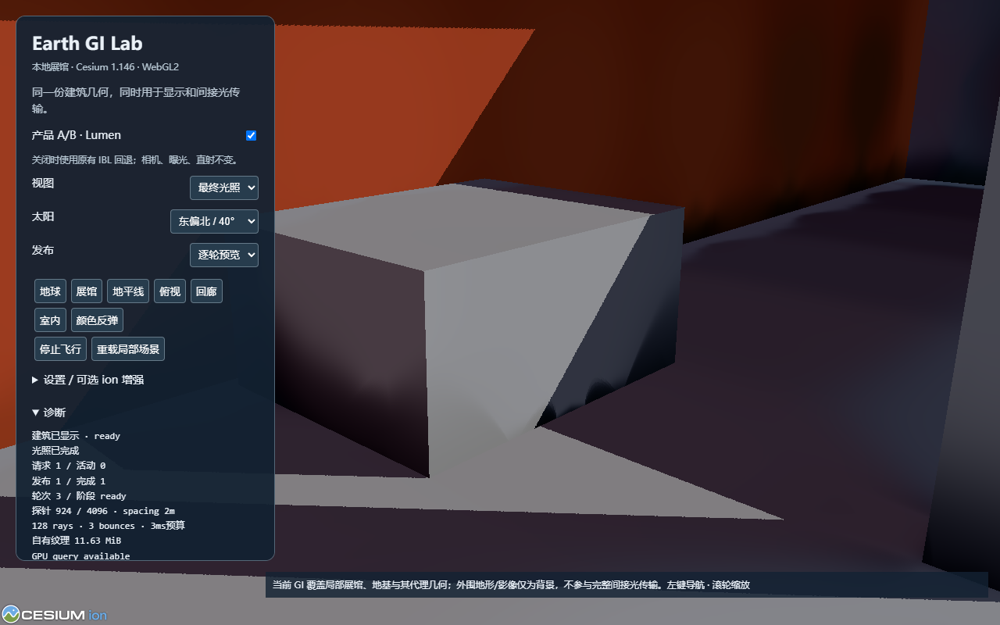
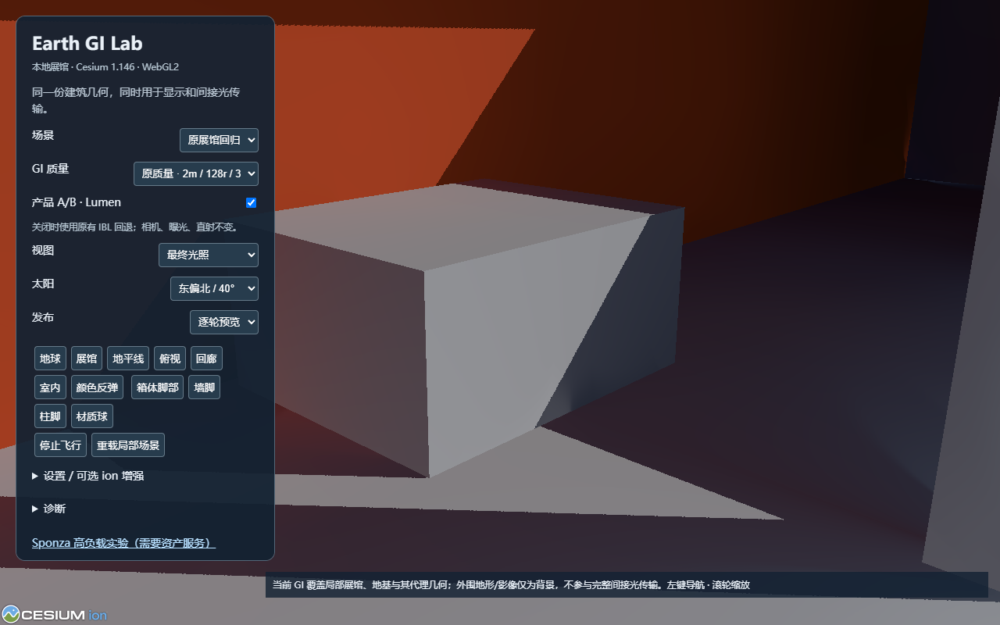
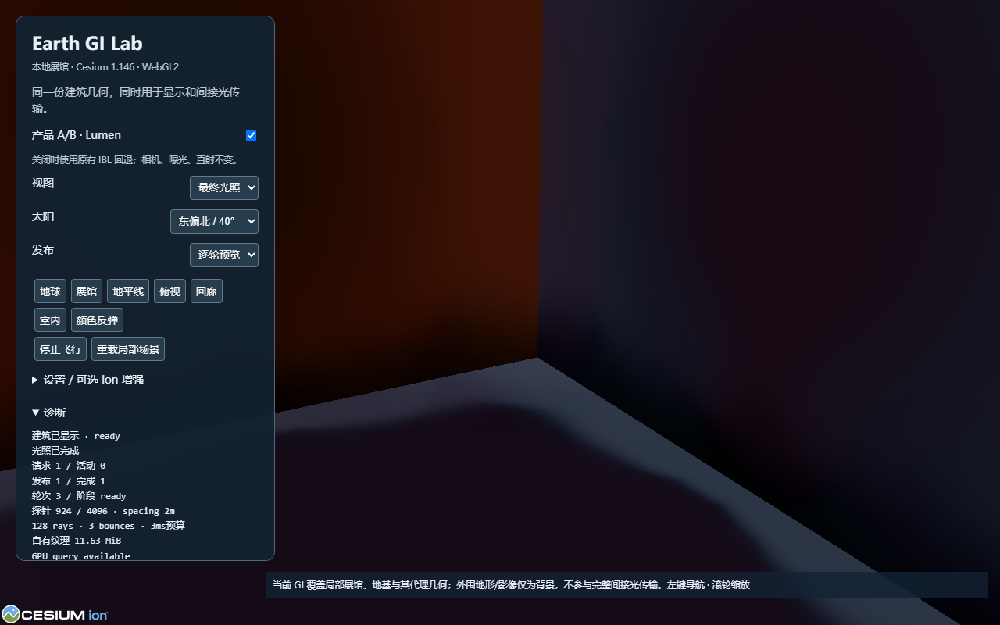
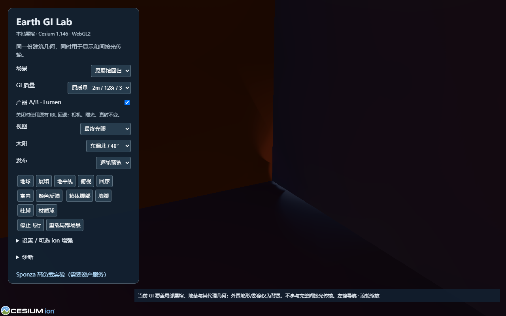
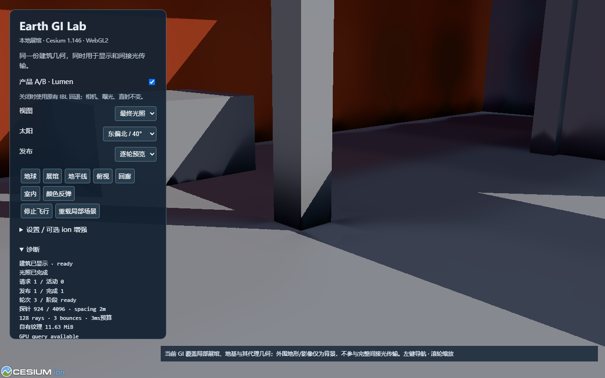
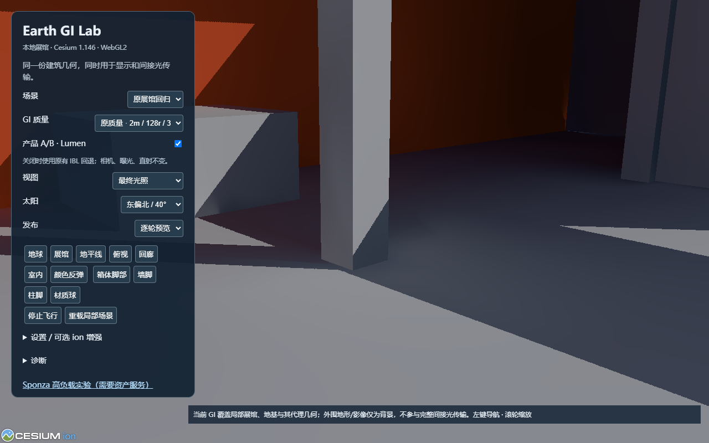
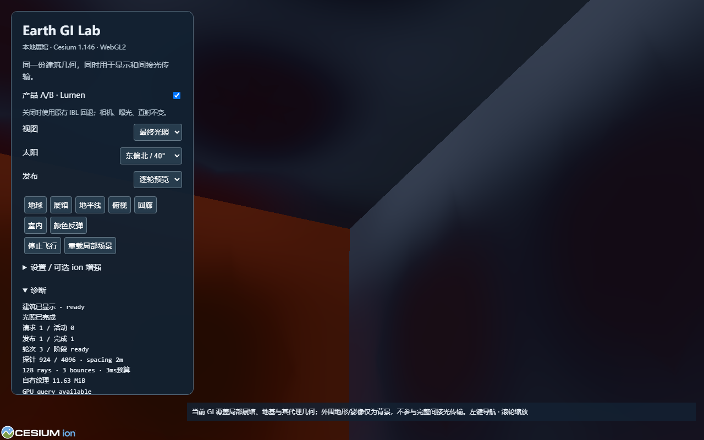
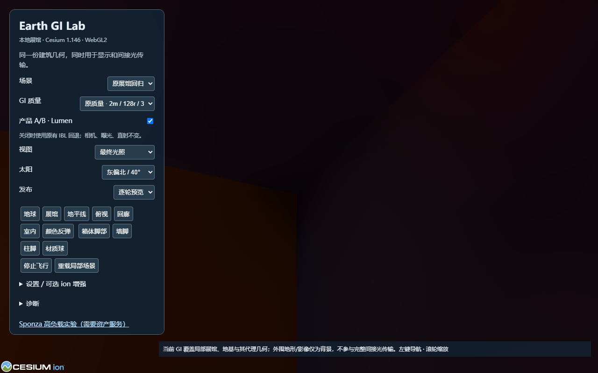
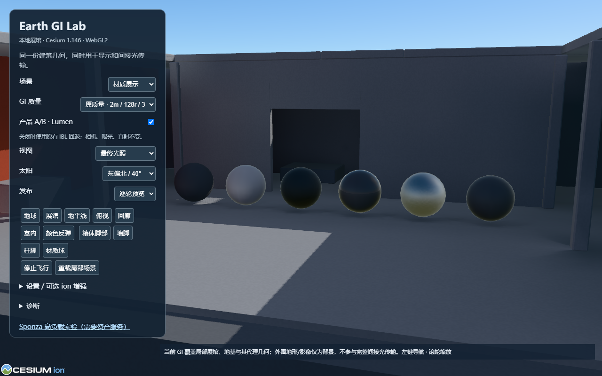

# R5：原展馆空间修复与材质展示

箱体侧面的扇贝状黑斑和墙脚的周期图案已在原 2m / 128 rays / 3 bounces 下实际改善。墙脚原始 E 的 RMSE 为 0.30354 → 0.00536；箱体侧面为 0.30399 → 0.09657。柱脚的绝对 E 仍过估计（0.03302 → 0.13299），因此本轮画质验收是部分通过，不能声称所有接触点已解决。20 组代码/浏览器回归全部 passed。

本报告与 summary.json、各阶段原始 JSON、截图共同组成证据。附件任务书被作为实现规格；执行授权来自用户消息。没有使用曝光、天空强度、换原机位、禁用阴影/可见性或提高探针密度来掩盖原问题。

## 入口与版本

最短运行步骤（Node 已配置）：

~~~powershell
npm run setup
npm run build
npm start
# 另一终端
npm run test:r5
~~~

- [默认原展馆](http://localhost:8090/demo/globe.html)：regression / 原质量 / Lambert / 1× MSAA / 原阴影 / 固定曝光 1 / PBR_NEUTRAL / 显示过渡关闭。点击“箱体脚部”“墙脚”“柱脚”。
- [独立展示预设](http://localhost:8090/demo/globe.html?preset=presentation)：受验证的 Cesium diffuse response、受控天空/地面 specular IBL、轻倒角、低对比材质细节、contact 阴影、HDR 4× MSAA。点击“材质球”。
- [同步诊断入口](http://localhost:8090/demo/globe.html?diagnostic=1)：只有此入口允许显式探针位置视图。控制台 earthLab.showProbePositions() 显示诊断点；false 清除。橙：选定闭合地基/箱体/柱体内部，红：无效，绿：有效；诊断点透过建筑显示，不属于成品光照。
- GPU 性能入口不带 diagnostic；不使用 preserveDrawingBuffer，也不创建 GBuffer。

初始工作区 main 为 cbf38d3a36cf6e6c4850d1f9bdd16297a1be2726，工作区干净。核对并 fetch 指定实现分支后，远端 feat/globe-demo-visibility-v3 HEAD 为审查基线 9406cafdd631721db2481d7dd9b53ab5b2418784，无额外后续提交。由该现有实现创建 feat/ddgi-visual-quality-v4。main 未变，没有 reset、自动合并或 push。

最终源码提交：fea491847f99126f665bb6538073edbf742786be。证据提交随后加入，不改变编译实现。Build/CesiumUnminified/Cesium.js 的 raw SHA-256 为 b6bf23ce964de142d9d2551f749a933a0b35de100ca53807b53eb1b9c5b31784，LF 规范化 SHA-256 为 bef5b40a0e7ae81c6a812f424041cf770caa82b6f80e58d1cbc42f95a311e9fb。summary.json 保存全部 41 个新增/修改源码、配置和资产的字节数及 raw/LF 哈希。各原始报告也保留运行时 HEAD、所涉源哈希、构建哈希，较早阶段不冒充最终构建。

分阶段提交：

- aaa8ef3 test(r5.0): reproduce pavilion artifacts with linear component and probe diagnostics
- ec88367 fix(r5.1a): separate solid topology from two-sided shading and bound probe relocation
- 4cdbf5c fix(r5.1b): preserve trilinear reconstruction and separate geometric bias from shading response
- c12433c feat(r5.2): conserve PBR diffuse energy and restore controlled specular IBL without SH readbacks
- f370409 feat(r5.3): add separate material presentation, contact shadows and verified HDR MSAA presets
- 63e2dcc feat(r5.4): add finite optional probe display transitions with independent texture ownership
- e1d99ce fix(r5): separate data coverage from energy and harden saved views and display controls
- 438b7ea fix(r5.1): escape touching solids without relocation cycles and bound geometric query bias
- fea4918 test(r5): consolidate compatibility checks and separate visual, AA and display-transition costs

## 同条件原场景截图

这是对原箱体、墙脚和柱体的几何定位复现视角；用户自由相机未知。before 与 after 使用同一书签、相机矩阵/投影、锚点、灯光、曝光、画布和显示阴影参数。1280×800；2048 ShadowMap；normalOffset=true；softShadows=false；maximumDistance=150；1× MSAA；FXAA 关闭；gain=1；自动曝光关闭；显示过渡关闭。原展馆 bin 和 metadata json 的 SHA 相同；glTF 改变的是正确的闭合实体/双面材质语义。不是新展示资产替代原图。

| 对象 | before | after：原 2m，未过渡/未全屏滤波 |
|---|---|---|
| 箱体脚部 |  |  |
| 墙脚 |  |  |
| 柱脚 |  |  |
| 室内顶角 |  |  |

原始查询 E、仅间接漫反射、coverage、直接漫反射、直接镜面、emissive、specular IBL、diffuse fallback、multiple scattering、ShadowMap visibility 和“同路径仅移除局部 GI”各有独立 PNG。见 before/、solid-only/、spatial/、after/。截图经过现有材质后续处理、大气和 tone mapping；不能当作线性 E 真值。diagnostics.json 的 GPU sample、八探针候选表与 HDR 读回数组是线性数据。

## 消融和根因

1. R5.0 实际 GPU 读回：地基严格内部 108 个位置全部被旧实现当成 active。独立线性场测试在 x=0.25 时得到旧值 0.035714 而非 0.25；失败记录保存在 r5.0-red.json。两项都是运行证据，不是仅凭源码推测。静止 60 帧线性 E 最大变化为 0，暗斑首先是固定空间偏差。
2. 单独关闭显示 ShadowMap，后端太阳可见性缓存不变，间接暗斑仍存在；直接/间接/阴影分量截图可对应检查。诊断 fixed-E、no-crush、no-visibility 控制仅作用于显示或显式 query，绝不进入 raw 反弹。no-visibility 只说明可见性对图案的作用，不能成为修复默认。
3. solid-only 把展馆闭合、朝外绕序实体改为单面并声明 giSolid；薄双面片继续支持双侧着色。双面着色与“实体内部”独立。无显式 metadata 的旧资产保留 !doubleSided 回退，这不是由双面标志判断真实闭合性的证明。迁移累计位移不超过 0.45 spacing，最多三步；经过实体出口后的剩余线段若有阻挡或 Unknown，就拒绝。真正暗室自由探针允许 valid 且 E=0。
4. spatial 只对 facing×visibility 的可靠性做 crush，再乘逻辑网格的三线性核。保留旧核诊断控制，未引入缓存 gamma、2π、额外距离缩放。固定可靠性的常量/线性场、跨 cell、八面体接缝、有效黑暗/无效边界、CPU/GPU 合同均实际测试。
5. 后续 review 找到两处剩余支持问题：数据可用比例被二次乘到已归一化的 E；相接地基/楼板的 bit-exact 正反面 tie 和出口反向选择导致迁移回环。前者现在只诊断 availability，局部漫反射与天空 fallback 按 resident volume 的光源所有权合成。八个 valid 但极低可靠性探针仍报告 coverage=1；E 可安全为 0，不把置信度伪装成缺数据。缺支持也不会在封闭室内接入无遮挡天空。
6. 仅迁移搜索/线段验证的 exact tie 优先选 solid backface 出口；普通 transport 的原 rank 和 any-hit 保持。轴对齐相接实体避免沿已离开的轴反向进入。最后仍完整分类；该规则不被宣称为任意斜面几何的单调性证明。最终 2m 为 921 active、3 invalid；选定实体内部为 0，地基内部剩余位置也为 0；实际最大累计迁移 0.822982m < 0.9m。
7. bias-sweep.json 在同一几何/moments 下逐档重新求解 raw 3 bounces，比较 0.15/0.075/0.02/0.005m。选择 min(spacing×0.075,0.02m) 的几何偏置，避免粗网格把墙脚/地面采样推出 15cm。Ng 决定偏置/朝向，Ns 只决定方向 E 与 BRDF；双面 Ng 按面朝向翻转，独立于 normal-map Ns。
8. exit-clearance/ 是独立的 2cm 出口间隔试验，柱脚误差更大，未采用；最终出口间隔仍为 8cm。solid-exit/ 是出口修正、旧 15cm bias 的中间对照，不能混作最终 after。

每条扫描线 49 点，导出八个候选的 logical/relocated position、state、E、moments、trilinear、wrap、visibility、可靠性、最终/总权重、availability 与 biased/kernel/Ns/Ng。最终还导出接收点独立后端 any-hit 太阳可见性，明确与显示 ShadowMap 分离。共享 GPU snapshot 的 CPU gather 用于合同一致性（实际峰值差 0.001023413720787958，门洞第 9 点蓝通道、GPU 0.209414 / CPU 0.210438），不充当画质独立真值。受控常量/线性 GPU 合同阈值仍为 1e-5；真实场的该差异另行保留，未声称所有接收点都小于 1e-4。

## 独立线性参考与剩余空间误差

reference-visual-quality.mjs 使用真实 BVH 和 glTF 材质，对六条扫描线每四点取一处（每线 13 点），每处 8192 条 cosine-weighted 独立路径；同 sun/upper-hemisphere sky/颜色，有限 3 次表面反弹。没有 DDGI gather、SurfaceCache 或 tone mapper。每点标准误差保存在 independent-reference.json。

下面比较最终显示采用的有效 diffuse E（乘材质 rho/π 之前）。before/solid-only/spatial 曾对 E 乘 availability；after/fine 在 resident volume 使用已归一化 E。报告同时保留 raw 和 composedError，防止以归一化前后不同口径夸大改善。

| 扫描线 | before RMSE | after 2m RMSE | fine 1.5m RMSE | 原质量不退化关卡 |
|---|---:|---:|---:|---|
| boxFloor | 0.188 | 0.180 | 0.170 | passed |
| boxFace | 0.304 | 0.097 | 0.105 | passed |
| wallFoot | 0.304 | 0.005 | 0.243 | passed |
| pillarFoot | 0.033 | 0.133 | 0.082 | failed |
| ceiling | 0.150 | 0.004 | 0.069 | passed |
| doorway | 0.090 | 0.088 | 0.062 | passed |

柱脚关卡 failed：原核与错误内部支持的误差偶然较低，正确剔除/迁出内部探针后仍有近柱表面方向场及粗网格过估计，不能把平滑后的外观当成准确。箱体地面整体 RMSE 只小幅下降，局部峰值仍约 0.495。1.5m 改善柱脚/门洞的一部分误差，但墙脚/顶角明显比最终 2m 更差；192 个地基内部点受更小迁移上限约束而保持 invalid，不偷加 sky。UI 标成“加密实验”，不是全面升级承诺；1m 4680 probes 超过 4096 上限，仍拒绝。

## PBR、环境与展示

合成在材质线性 HDR 完成：shadowVisibility×(directDiffuse+directSpecular) + localIndirectDiffuse + diffuseEnvironmentFallback + environmentSpecular + explicitSpecularMultipleScattering + emissive，然后才经过引擎后续大气、曝光、tone mapping 和编码。GGX 沿用原 Cesium；Lambert 的 rhoE/π 验证模式保留。cesium 展示响应使用当前 Fresnel/多散射后的 dielectricScattering；material.diffuse 已含 metallic 衰减，不重复乘 (1-metallic)，不多除一次 π。太阳阴影只衰减直接光。

能量验证用真实 engine IBL shader 的单位辐亮度白炉，90 种颜色/metallic/roughness/NdotV 组合，加 3 个 coverage、2 个 source scale、分量读回。白炉上界 1.015，强度翻倍线性响应；金属 local diffuse=0；specular multiple scattering 不随 diffuse coverage 消失或重复。直接 BRDF 仍复用现有实现。仅移除局部 GI 的消融保持其余能量分配。原 clearcoat/anisotropy 等支持门控未扩大。

LightingEnvironment 保存手动 sun 方向/强度/颜色、常量半球 GI sky、specular 大气/地面来源与朝向/请求发布版本。DynamicEnvironmentMapManager 实际生成 64×64 cube、0..6 mip，方向/roughness 响应和手动太阳刷新通过。修复 specular-only 异步生成后下一帧未通知 model shader 的问题，真实前向 command 有 SPECULAR_IBL；generateSphericalHarmonics=false 跳过原 3×3 同步 SH 读回，默认 API 行为保持。演示 imageBasedLightingFactor=(0,1)，不增加漫反射天空。

GI 常量半球与真实大气 specular 来源是明确的受控近似差异，未以 exposure/gain 配平；天空/地面环境不包含建筑反射。transport 仍使用三角形宏观法线；展示球的光滑着色法线不被伪称为精确曲面传输。base color/emissive 按 sRGB 解码，MR/normal 参数线性，低对比细节 texture 没有 baked GI/AO。资产自生成，无新第三方资产许可。

展示只改独立 presentation 资产：3.5cm 倒角，灰/白/深色介质、粗糙/光滑灰介质、金属材质球，线性 mip 过滤；原 regression bin/metadata 不变。contact 阴影保留 2048、原深度 bias，normalOffset=false、softShadows=true、maximumDistance=75m。这是 PCF 显示太阳阴影，不是面积光 GI。HDR framebuffer 实际 numSamples=4 已验证；FXAA 可选，AA 不是 GI 去噪。PBR_NEUTRAL/ACES 对照固定曝光，默认仍选 PBR_NEUTRAL。

[展示全景](presentation/overview-final.png)、[箱体](presentation/boxFoot-final.png)、[4× MSAA](presentation/materials-aa-msaa4.png)、[FXAA](presentation/materials-aa-fxaa.png)、[原阴影](presentation/shadow-original.png)、[contact 阴影](presentation/shadow-contact.png)。阴影分离仍受深度 bias/cascade 分辨率和接触几何影响，未宣称完全根治。

## 时间结果与可选显示过渡

最终静止 60 帧 E 最大变化 0。改灯时最大相邻 raw E 跳变：progressive 0.217402，snapshot 0.111764（publication-sequence.json 保存逐帧值和发布事件）。这是有限轮发布跳变的证据，不是随机噪声。

可选 transition 默认关闭；普通 150ms，大 sun/energy 变化上限 50ms，总允许 0..250ms。history/goal/shown 为三个独立拷贝纹理，raw solver 下一反弹始终读原始 atlas，snapshot 和 completed 保留原语义，displaySettled 独立。geometry/material/rayLayout 变化严格失效；同一 progressive revision 中启用/改时长也立即按下一轮的新设置工作。

实际测试：开/关后 raw E 最大差=0，初始显示差存在，完成后显示回到 raw（<1e-6），额外绘制停止，历史不会被 solver 复用覆盖，关闭/销毁释放，显存预算不足原子拒绝，无纹理反馈。原型不是统计去噪，不增加采样信息。

## GPU 时间、帧率与显存

设备：Windows / Chromium 154.0.8037.98 headless、页面 visibility=visible、ANGLE RTX 5080 / D3D11 / WebGL2；1280×800；ShadowMap=2048；原质量都 128 rays / 3 bounces / 3ms 调度预算。GPU 使用 EXT_disjoint_timer_query_webgl2，结果仅异步查询，disjoint=0。表中 static 为整帧 GPU P50/P95；CPU rAF 约 240Hz，不能解释成设备吞吐极限。before 的更新 FPS 旧 harness 混入 settled 帧，明确 not-run，不冒称纯更新 FPS。

| 配置 | spacing / probes | 静态整帧 GPU ms P50/P95 | 静态/更新 rAF FPS | GI MiB | GL纹理 / RB / buffers MiB | 合计估计 MiB |
|---|---|---|---|---:|---|---|
| before | 2 / 924 | 3.512 / 4.340 | 239.976 / 未单独测更新帧 | 11.63 | 176.55 / 0.00 / not-run | 176.55（不含 buffers） |
| after | 2 / 924 | 3.121 / 3.677 | 239.976 / 239.913 | 11.63 | 176.55 / 0.00 / 3.81 | 180.37 |
| fine | 1.5 / 1764 | 2.972 / 3.394 | 239.976 / 240.066 | 22.11 | 187.04 / 0.00 / 3.81 | 190.85 |
| presentation | 2 / 924 | 3.303 / 3.972 | 239.976 / 240.137 | 12.88 | 177.95 / 93.75 / 4.15 | 275.85 |
| presentation-msaa1 | 2 / 924 | 3.170 / 3.792 | 239.976 / 240.000 | 12.88 | 177.95 / 0.00 / 4.15 | 182.10 |

GL 估计包含 Globe、HDR、阴影、IBL、GI、MSAA 和本轮 bufferData 分配的几何/其他 buffer；不含 driver padding、浏览器 canvas swapchain/外部副本。baseline 没有 buffer 追踪，所以只能比较同口径纹理/RB（2m 前后同为 176.55MiB），不能把 before 合计当完整 VRAM。GI owner 精确计数与整场估计分开；presentation 的几何/材质 atlas 更大，不与原展馆冒充等质量比较。

同 presentation 1×→4×：额外 RB 93.75MiB，静态整帧 P50 3.170→3.303ms，P95 3.792→3.972ms。真实 HDR 4× 路径有效，内存代价明显。

一次原质量改向重照的累计 GPU 阶段 ms（跨帧累加，不是某一帧耗时）：

| 阶段 | before | after 2m | fine 1.5m | presentation 2m |
|---|---:|---:|---:|---:|
| visibility | 0.438 | 0.060 | 0.776 | 0.280 |
| direct | 0.014 | 0.016 | 1.595 | 0.422 |
| bounce | 0.162 | 0.447 | 1.664 | 0.339 |
| integrate | 0.386 | 1.118 | 0.770 | 1.084 |
| border | 0.030 | 0.716 | 1.311 | 0.027 |

一次初始化几何阶段 GPU ms（shader 首次编译的 CPU 等待不算 GPU 时间）：

| 阶段 | before | after 2m | fine 1.5m | presentation 2m |
|---|---:|---:|---:|---:|
| relocate | 0.761 | 4.729 | 1.396 | 3.102 |
| intersect | 1.244 | 1.053 | 3.450 | 0.915 |
| classify | 0.994 | 2.983 | 5.078 | 1.936 |
| moments | 0.419 | 3.158 | 1.754 | 1.185 |
| momentsBorder | 0.713 | 0.140 | 5.608 | 0.455 |

| 配置 | request→首次完整轮提交 ms | request→最终完整轮提交 ms | 改向重照 GPU 总 ms |
|---|---:|---:|---:|
| before | 64.800 | 98.100 | 1.029 |
| after | 52.900 | 98.600 | 2.357 |
| fine | 77.400 | 127.500 | 6.115 |
| presentation | 27.400 | 64.900 | 2.152 |

首次/最终是 CPU 提交和 atlas 选择，既不是 GPU fence 完成也不是屏幕呈现。baseline 顶层 finalSubmissionMilliseconds=416.4 是旧测量窗口终点，表中用世界自记录 requestToFinalSubmissionMilliseconds=98.1；不把无关等待当改善。重照只改变 raw GI 的方向，保持 Scene 灯光/相机稳定，以隔离求解成本；同步 Scene/IBL 改灯正确性另由 pbr-environment 验证，整套动态环境重生成性能未单独计时。

空间正确性增加了 gather 的法线/分支运算和初始化出口/阻挡验证。静态整帧未出现大幅退化，但一次 warm relight 累计 GPU 1.029→2.357ms，不能宣称求解更快。小批次计时/调度及渲染竞争有波动（presentation 两个 AA run 的相同求解阶段差异也可见）；只提供实际一次 run 原始数据，不把阶段变化归因成已证实的 GPU 时钟结论。

可选显示过渡在 2m 额外精确 4,435,200 bytes（4.23MiB）；1.5m 计算为 8,467,200 bytes（8.08MiB）。performance-display.json 实测一次 150ms 过渡 58 个拷贝/混合 draw：总 GPU 0.392ms，每 draw P50 0.00742ms / P95 0.00883ms；raw 完成后约158ms显示稳定，之后无额外 draw。生产/性能 phase 内 readPixels/getBufferSubData/finish/waitSync/阻塞 clientWaitSync 为 0，无 query collision、反馈、GL error。

## 验证状态及剩余工作

- passed：build；20 组 pipeline、transport、环境、Globe controls、CPU visibility、真实 fixtures、relighting/cache、integration、snapshot/progressive、publication lifecycle、GPU visibility/domain/edges、真实 Globe/本地回退、solid probes、spatial CPU/GPU、PBR/IBL、保存/恢复/AA/shadow、display ownership。test-suite.json 保留 stdout/退出码/时间，compatibility-raw/ 保留原报告与截图；上一轮 reports/globe-visibility-v3 完全恢复，未覆盖历史证据。
- passed：最终 after/fine/presentation finite data、实际 BVH→分类→积分，封闭箱、薄双面片、门洞暗室、重叠楼板、内部探针与位移上限；量化 after 的五条扫描线 RMSE 不退化。
- failed：原质量 pillarFoot 独立绝对 E 不退化验收（见上表）。外观的周期纹减轻不等于这一关通过。fine 的墙脚/顶角质量也不如最终 2m，暂保留实验标记。
- 已修复的 failed 运行：r5.0-red 为故意复现旧错误；failed-first-* 保存 CPU double/GPU float32 方向精度误判与 shader cache 正常释放的旧验证失败。新的独立矩积分读取实际 float32 方向后仍由 CPU 单独计算（最大 error 2.23e-5、normalized error 0.0082；direction 相对理想双精度最大 3.70e-5），未放宽原阈值；资源断言仍禁止 texture/FBO 增长与 shader pool 增长，但允许释放闲置 shader。旧 failed HDR multisample 读回/IBL notification 图片明确属于中间失败，最终读的是 resolve framebuffer。
- not-run：外部 Sponza 高负载资产链、真实认证 ion（没有用户 token；实际 401/403 mock 和无 token 回退已测）、整套 Scene+IBL 动态重生成 GPU benchmark、跨 GPU/浏览器性能。没有将小 fixture 的结论冒充 Sponza。

仍需处理近柱表面的粗网格过估计与局部箱体地面峰值、1.5m 缺支持/漏光偏差、部分 shadow contact/cascade 分离、动态环境与常量 transport sky 的近似差异。保留默认 2m 和未过渡结果。没有新增全屏时空 GI 去噪、SSGI/SSR、追踪反射、动态几何、Tiles/地形 GI 或 WebGPU；Globe/外围地形仍是背景。

Standards/Spec 两轴 review 已修复 saved-view 并发世代、atomic async save、同轮 transition 时长、Ng 朝向、极低权重 availability、diffuse 二次支持衰减和相接实体回环；final geometry review 未发现新的 pavilion blocker。柱脚的经验性验收缺口保留，未用“全部通过”掩盖。
