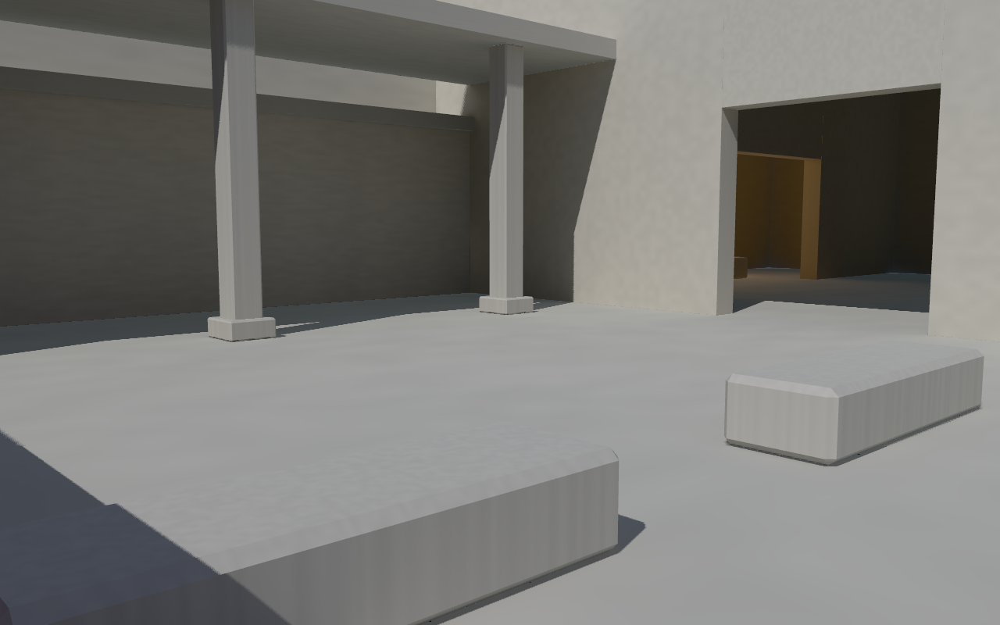
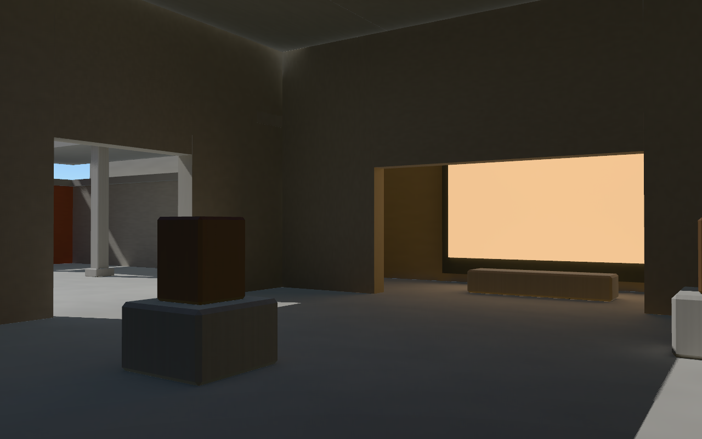
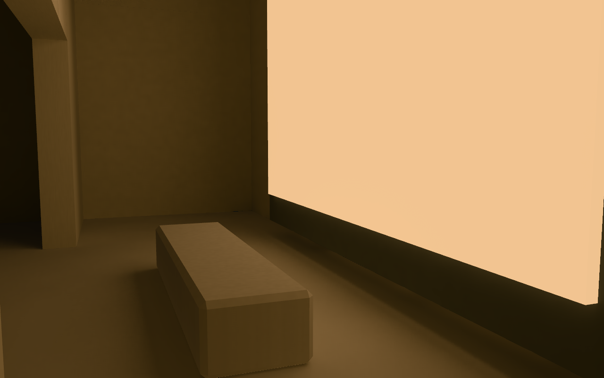
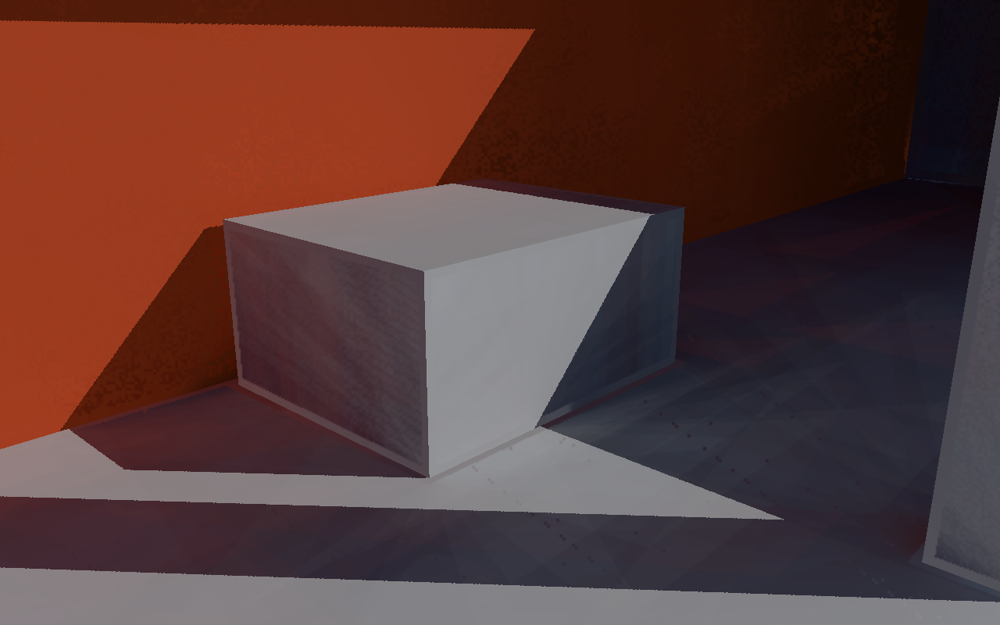
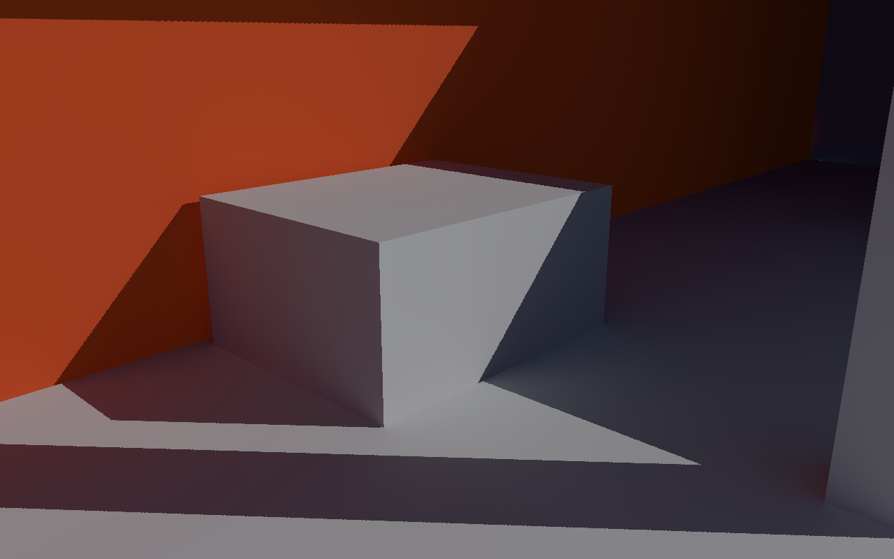

# R7：接收表面 FG 重建与 Earth GI Gallery

从实际 HEAD d7e20edc13be6d9d7798d686cba83bdf3f7b6223（feat/receiver-final-gather-v5）创建 feat/fg-reconstruction-showcase-v6。保留完整 R5/R6 提交链，没有回退 main 或自动合并。

本轮实现了二维像素/时间去相关、线性 E 历史重投影、方差/几何过滤、带世界线段保护的上采样，以及独立 Gallery。**DDGI 保持默认；重建 FG 仍是实验模式。** 原场景画质改善与 Gallery 资产改善分别验收。性能超预算时总验收返回 1。

[可运行证据查看页](http://localhost:8090/reports/fg-reconstruction-showcase-v6/index.html) · [Earth GI Gallery](http://localhost:8090/demo/gallery.html) · [原展馆](http://localhost:8090/demo/globe.html)

## 执行结果

| 类别     | 状态   | 证据范围                                    |
| -------- | ------ | ------------------------------------------- |
| 回归     | passed | lint + 25 项既有行为 + R7 合同/生命周期     |
| 静态画质 | passed | 12 canonical / 57 actual Scene / 512 关卡   |
| 时间画质 | passed | 37 步变化 + 深度/多视锥/正交 + 20 资源循环  |
| 性能     | failed | 三轮交替完整 GPU 窗口，两个 P95 目标超限    |
| 展示     | passed | Gallery 三空间 / 书签 / 地球 / 同曝光源开关 |

质量正常入口退出 0；注入柱脚误差入口退出 1。总验收退出 1，推荐标记 false。完整结果在 [test-suite.json](test-suite.json)，阈值计算在 [quality.json](quality.json)，故障传播矩阵在 [acceptance-faults.json](acceptance-faults.json)。

总入口要求实际子进程成功，不能靠旧 passed JSON 覆盖失败。缺少必要 performance checks、窗口不完整、子进程 exit 1 / null、源码或编译包不匹配均拒绝通过。已有 tracked/untracked 历史报告恢复原字节，新兼容性证据放在 compatibility-raw；历史 R6 失败记录没有改成通过。

## 原配置与证据边界

原展馆资产、boxFoot / pillarFoot / ceiling 相机、2m / 128 probe rays / 3 bounces、曝光 1、原阴影与抗锯齿设置保留。主档 half32r，补测 half16r、quarter16r 和 full64r 中央 256×256 ROI。原场景的阴影、太阳、天空、coverage、反弹数未用于掩盖错误。

- 十二组 canonical：原场景及 17°/错位 held-out × 16/32r × seed 0/5/19；每组六条扫描线、每线全部 49 点。canonical 的补充机位用于可见表面和解析 Ng 的 shader helper 查询；它们不替换三个原问题机位，也不冒充真实屏幕像素。
- 五十七组 actual Scene：原场景、held-out、Gallery、25° / 0.05m 隔墙、full ROI 与 quarter 档。每组保留 1/4/8/16/32 有效帧，连续 64×48 ROI 全部 3072 点，以及实际最终 E_used、全视口 weight/fallback 和 24×16 的独立路径样点。
- C 为同接收点、同 revision/round 的 1024r world-traced FG，三个独立序列。它衡量重建误差，仍包含 E_(k−1) 的探针插值误差。
- D 为独立路径参考。canonical 明确复用已冻结且 SHA256 固定的 R6 8192-path D，保留独立标准误差；actual Scene 在实际接收位置新算 4096-path D。原几何、材质和照明一致性逐项核对。C 不能代替 D。
- primary / solar Unknown、无深层 E、raw 无效点和回退都保留。owned surface 是显示模型可支持的接收表面；天空/不支持材料不混入该分母。全分辨率 ROI 之外按定义回退，不把低全视口覆盖标成通过。

各报告记录 HEAD、归一化源码 SHA256、测量/诊断 helper、编译包哈希、资产哈希、实际相机与输入。HEAD 是测量时的提交；额外源码哈希才是具体被测内容。最终证据由锁定源码重新生成，缓存入口核对全部必需和额外依赖，不把中间快照称为最终树实测。

| 原实际机位（half32r / seed 0） | raw 第1帧 / C RMSE | 重建第32帧 / C RMSE |   改善 | 最终 E_used / D RMSE | 实际 FG 覆盖 |
| ------------------------------ | -----------------: | ------------------: | -----: | -------------------: | -----------: |
| original-boxFoot-high-s0       |        0.026154263 |         0.005198076 | 80.13% |          0.021283231 |      99.978% |
| original-pillarFoot-high-s0    |        0.022527419 |         0.003388651 | 84.96% |          0.013266800 |      99.394% |
| original-ceiling-high-s0       |        0.019268364 |         0.001339917 | 93.05% |          0.003014598 |     100.000% |

| canonical 六线（32r / seed 0） | 锁定门限评分 RMSE / D | 全49 RMSE / D |   覆盖 |
| ------------------------------ | --------------------: | ------------: | -----: |
| boxFloor                       |           0.017626111 |   0.018135878 | 100.0% |
| boxFace                        |           0.051285347 |   0.051714562 | 100.0% |
| wallFoot                       |           0.002001954 |   0.002318320 | 100.0% |
| pillarFoot                     |           0.011680540 |   0.011548493 | 100.0% |
| ceiling                        |           0.002101801 |   0.002194807 | 100.0% |
| doorway                        |           0.003894079 |   0.003898579 | 100.0% |

原六线的绝对门限和不退化门限采用既有精确数字，包括柱脚 0.033018738250725134。保留失败点，未扩大参考标准误差；独立数值与实际覆盖关卡共 512 项。canonical 保留全部49点；历史门限按锁定报告原有 scoredIndices 评分，索引未改，同时单列全49 RMSE。实际 Scene 的3072点 ROI 另行全点评分。

[canonical.json](canonical.json) · [screen/data.json](screen/data.json) · [quality.json](quality.json)。screen 下 deflate JSON 包含 raw/history/moments/filtered/位置/Ng/保护 mask/connections/C/D；before 下保存完整基线附件。条纹评价同时记录连续 ROI 横向/纵向误差自相关，未只选择单点。

## 实际改动

### R7.0：复现与计时

保留原相机的直接光、DDGI E、raw E、重建 E、E_used、weight、保护 mask、shadow 和 fallback 原因。LumenGpuTimer 按 context 广播 disjoint，连尚不可用的 pending query 一并删除，避免读取 cleared flag 后另一 owner 接受污染值。无 timer 扩展不创建无限帧账本。

完整帧在所有 query 收齐后才进入分项统计；队列背压按整帧跳过仪表，不中断 FG 绘制。计时 cap 128，帧开始 pending >32 时保留槽位。source/unsupported/outside/resource 的回退原因不再保留旧成功值。真实 World 构造器的 Worker / 初始 postMessage 失败已验证不残留 Worker 或 timer owner。

### R7.1：真实新样本

共享 sampler 同时扰动 cosine-hemisphere 的两个维度，散列二维像素、seed 与实际采样 epoch。trace/shade 使用相同状态，每个四射线 chunk 重新追踪相应 hit；不旋转 phi 后复用旧 hit。

fixed-reference 保留旧固定序列。scrambled-single-frame 固定 epoch 0，无历史；reconstructed 随真实 FG 采样推进 epoch。sequenceEpoch 可固定，null 显式解除，重复序列不增加有效历史。

测试覆盖 CPU/GPU 方向一致、常量天空/黑半空间/矩形的解析积分、真实世界 RGB 材料 1/2/3 反弹与三 seed 收敛。解析积分明确是实际编译 sampler 的积分测试，不能冒充新增 BVH 场景；真实 BVH 由后续世界/隔墙/屏幕检查覆盖。解析二值积分采用由解析概率得到的三个独立 Bernoulli 标准误差，不由候选误差决定容差。

### R7.2：只积累线性 E

低分辨率 ping-pong 历史分别拥有 E/长度、亮度一二阶矩、局部 P/表面归属与 Ng。用 CPU 完整相机 projection × local view 重投影，不用最后一个子视锥的临时投影，不用 ECEF float 或解码后的屏幕深度。

验证 revision、round、world 实例、几何/材料/光源版本、位置、Ng、owner、视口和 source key。正常运动保留重投影，切镜、新源、重载或显露按规则拒绝。raw 有效黑值可以积累；Unknown 不能积累。历史没有反馈到 DDGI、surface cache 或 E_(k−1)。

FP16 统计附件有明确溢出保护；raw RGBA32F 保留。31 个零值加一个 E=100 的真实 GPU 测试结果为 3.125，未用 sample-driven clamp 把稀有亮值变成偏差。峰值保护触发时只拒绝历史，完整 raw 仍可使用；半精度误差另行测量。

### R7.3：方差与世界几何保护

四邻接连接先验证归属、Ng、面距，再在同一世界 BVH 查短线段。两轮 cross filter 使用已验证的路径、局部距离与方差；不是 SceneColor 模糊。raw 能否使用与邻居能否借用分开。

上采样选几何对应的中心，遇到原保护 mask 不安全时仍进行有预算的世界线段检查。有效重建替换完整 E；数据不足安全回退 DDGI。未直接关闭防穿墙，未把所有点回退 DDGI，未把过滤值反馈给求解器。

## 时间变化、生命周期与生产合同

[temporal/data.json](temporal/data.json) 保留静态 32 帧、横移、绕柱、门洞显露、快速转头、太阳跳变与连续拖灯、曝光、resize/AA、固定序列、requestRenderMode 停止/唤醒、材质世界重载的逐步截图和线性误差。

[history.json](history.json) 实际检查普通/对数深度下的八个 frustum 区间，局部接收位置差为 0，每个 Scene lifecycle 一次 FG；正交宽度变化重新采样。主循环停止计数只增加真实新信息，camera cut/source 首次累积不会少算一帧。

[lifecycle.json](lifecycle.json) 实际执行 20 轮启停、尺寸/AA、World reload，FBO 故障注入回滚，WEBGL_lose_context 后重新创建 Scene，Chromium frozen→active。快照旧 owner 拒绝跨世界复用，释放后迟到 lease 安全。生产 GL observer 窗口没有 readPixels、finish、阻塞 wait 或图像反馈；诊断显式同步，未混称生产。

not-run：真实 OS 后台/挂起恢复、原 Scene 原地 WebGL restoration、带 token 的 ion/World Terrain、其他 GPU。Chromium frozen→active 与真实 context loss 后重建 Scene 已运行；两者不冒充这些未测范围。

## GPU 与显存

| 轮次 | 模式          | GPU P50 ms | GPU P95 ms | whole query 样本 | 实际 FG 帧 |
| ---- | ------------- | ---------: | ---------: | ---------------: | ---------: |
| 1    | ddgi          |      3.167 |      3.735 |               80 |          0 |
| 1    | raw           |      4.002 |      5.242 |               80 |        100 |
| 1    | reconstructed |      7.247 |      7.780 |               80 |        100 |
| 2    | reconstructed |      7.226 |      7.644 |               80 |        100 |
| 2    | raw           |      3.808 |      5.484 |               80 |        100 |
| 2    | ddgi          |      3.332 |      3.693 |               80 |          0 |
| 3    | ddgi          |      3.259 |      3.795 |               80 |          0 |
| 3    | raw           |      3.999 |      4.781 |               80 |        100 |
| 3    | reconstructed |      7.141 |      7.669 |               80 |        100 |

设备 ANGLE (NVIDIA, NVIDIA GeForce RTX 5080 (0x00002C02) Direct3D11 vs_5_0 ps_5_0, D3D11)。新增重建相对 raw FG 的平均独立窗口 P95 差为 **2.529ms**（目标 ≤1ms）；完整 FG 相对 DDGI 为 **3.957ms**（目标 ≤3ms），均 failed。完整 query / FG 活跃帧 / 64MiB / 生产无同步读回检查 passed。重建窗口 trace 均值约3.94–3.96ms、shade约2.23–2.26ms；连接+时间+两轮过滤约0.22–0.26ms，昂贵部分不能只归到过滤。

FG 新增自有纹理包含 receiver、raw/ping、guide/mask、history/moments/filter 和不可变 round snapshot；原展馆 half32r 为 63,373,760 B（60.44 MiB），Gallery 同档 66,061,952 B（63.00 MiB）。两者在 64 MiB 内；这些数值不冒充整个 Cesium/驱动进程的 VRAM。metadata 分别列 primary、solar 与几何保护射线的上界，ray slots 不是所有物理查询的总数。

history/moments/P/Ng 的双缓冲为 80 B/低分像素，连接 4 B、两张过滤附件 16 B，共 100 B/低分像素。显存成本来自实际分配记录，不是截图尺寸估算。超过预算、不支持材质或 sampler 数不足时明确回退；16 fragment sampler 的实测设备已验证 Gallery 纹理材质。五贴图等超过 adapter 预算的组合保留安全回退。

完整 query、实际 FG 帧数、stage means、渲染帧与 rAF poll 区分记录在 [performance.json](performance.json)。三轮交替独立窗口，每窗暖机 20 / 实际绘制 100 / GPU 样本 80；分项另窗收 60 个完整 FG query 组。独立窗口 P95 差不当作逐帧配对差，分项均值不直接相加为 P95。

## Gallery 独立展示

自创 glTF+bin+低对比程序纹理，31×23×7.85m，980 三角形、6 材料、1 张 64×64 纹理；BVH 377 nodes / depth 11，2m 网格 18×14×7 =1764 probes。真实地基、台阶、倒角、天窗、厚墙/门洞和 6.5×3.8m 发光面都进入 GI。无 baked GI/AO/阴影，不依赖资产服务 8008。

庭院、天窗展廊和发光壁龛共用同一静态资产、轴向、ENU 锚点与原子 placement。真实 Cesium Globe 使用本地 NaturalEarthII / 椭球，无 token 可用；外围 Globe/地形仅作背景，未宣称完整 GI 或本地追踪反射。可选 ion 地形接口保留。

首屏建筑全景，六个书签包括地球、庭院、天窗、门洞和壁龛。曝光均为 1，昼间/斜阳/夜间真实参数可保存，不包含 token。发光面开关通过同 bin 的材质预设原子重载显示/GI；这不是任意动态几何或实时动态材质支持。技术控制折叠，HUD 区分 source passes / static passes；每像素有效历史见诊断附件。

Gallery 的 -raw.png 是 **raw E 诊断视图**，不是与 final RGB 相同含义的材质图像。最终同条件对照是 -without-local.png / -ddgi.png / -reconstructed-32.png；没有以 raw E 对 final RGB 的亮度差冒充改善。

## 同条件原问题前后

两张均为 boxFoot、1280×800、half32r、2m/128/3、曝光 1、原直接光与阴影。

可运行查看页可切换三原机位、held-out、Gallery、隔墙及 1/4/8/16/32 帧，并列显示线性误差/覆盖，不额外渲染第二遍 Scene。

## 复现命令与模式

    npm run setup
    npm run build
    npm start
    npm run test:r7
    npm run test:r7:quality
    npm run test:r7:temporal
    npm run test:r7:lifecycle
    npm run test:gallery
    npm run benchmark:r7

完整 test:r7 重新测量；--cached 复用已有数值/成本且核对全部记录依赖与必需依赖；--fast 未跑画质/时间/性能/展示，不能产出完整 passed。关闭 server 时明确失败，不沿用旧成功 JSON。测试的 failed 退出不是建议改门限。

可通过 Earth GI Lab 高级控制选择采样策略，或：

    await scene.lumen.finalGather.configure({
      mode: "fg",
      quality: "high",
      sampling: "reconstructed",
      seed: 0,
      model,
    });

静态场景积累 32 个新采样帧后停止新增 FG；正常相机移动重新积累/重投影。continuousSampling 仅为诊断成本窗口持续采样。fixed-reference / scrambled-single-frame 保留无历史对照。

## 剩余缺陷

- GPU 预算仍失败。去相关追踪降低 ray coherence；主要成本在 trace/shade，不能只报告较便宜的过滤 pass，不能把高帧率或静态停采样当持续活动成本通过。
- C 与 D 的差异仍含有限探针 E_(k−1) 的偏差；Gallery 天窗/发光区的总路径误差没有被过滤消除。隔墙右侧仍有小的深层求解残差，数值保留，不宣称零漏光。
- 同 owner 的保守几何路径检查对 alpha-mask 当作遮挡，可能少借光。Ns!=Ng、透明材质、超 sampler/预算视图继续回退。
- 原回归图仍有直接阴影与原 AA 的锯齿/采样痕迹；本轮 GI 重建没有把它们用全屏模糊抹掉。
- 支持静态单世界模型。未实现反射、动态几何、Tiles GI、完整时空去噪、Cards/SDF 或 WebGPU。
- 原 Scene 原地 WebGL restoration、真实 OS 挂起恢复、带 token 的 ion/其他 GPU 尚无本轮实测。

## 提交链

- a89e5b1 fix(r7.0): preserve component evidence and invalidate disjoint pending timers
- bfb5200 feat(r7.1): decorrelate both FG dimensions across pixels and sample epochs
- 346f49e feat(r7.2): reproject linear FG history with source and geometry validation
- b9ee6c9 feat(r7.3): reconstruct linear FG with variance and world geometry barriers
- 948a158 feat(r7.scene): build Earth GI Gallery with courtyard skylight and emitter presets
- 23a46fb fix(r7): bound complete-frame timers and validate reconstruction lifecycle
- 8dbdccf fix(r7.acceptance): reject stale successes and pin measurement dependencies
- 68835d5 fix(r7.reports): retry transient historical report locks and record failures

全部在 feat/fg-reconstruction-showcase-v6；远端推送与最终 SHA 见交付回复。main 不合并。引擎导出补丁经原始 baseline apply 后逐文件比对，在 compatibility-raw/receiver-final-gather-v5/export-patch.json 记录 27 个文件。
